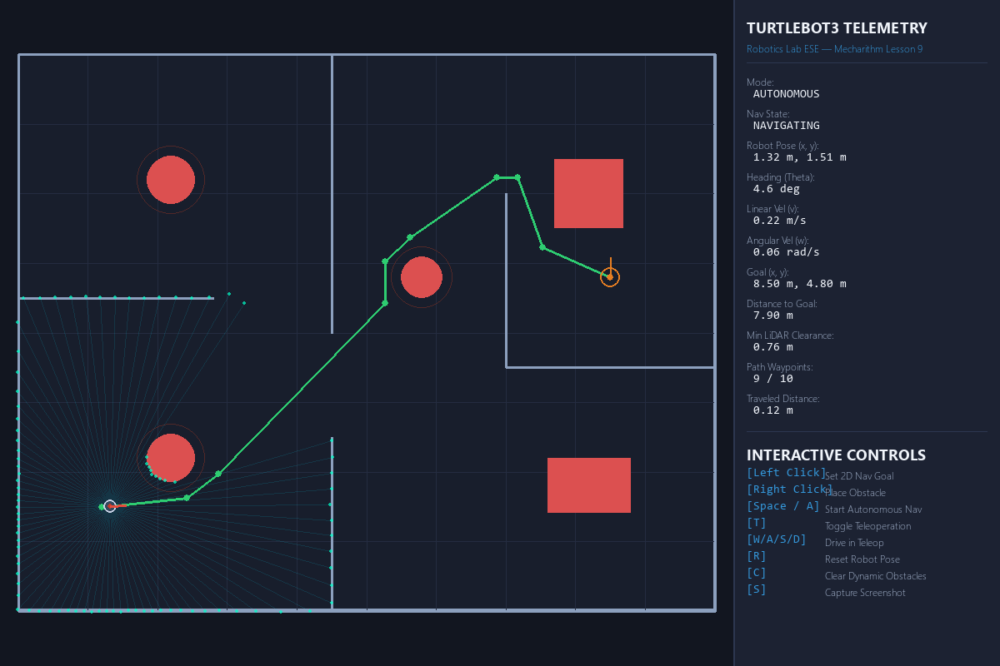
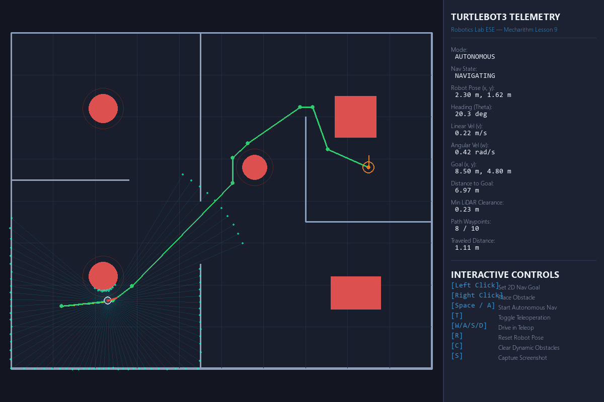
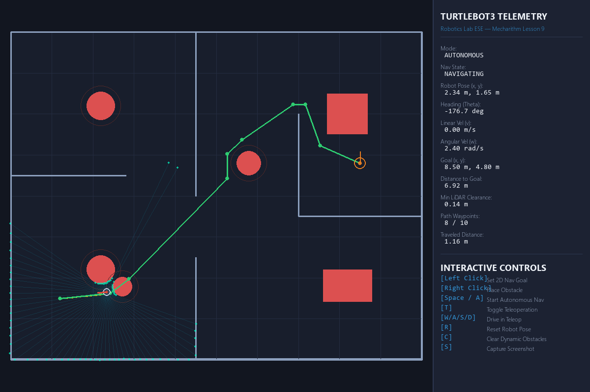
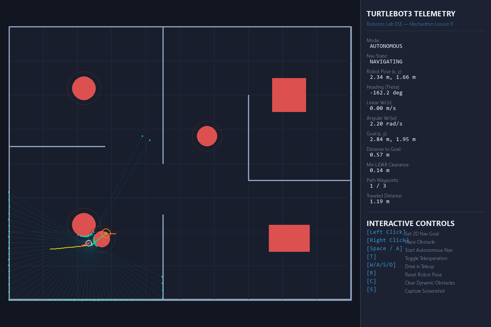

# TurtleBot3 Autonomous Navigation Using ROS 2 (Windows 11 Native)

[](https://microsoft.com/windows)
[](https://docs.ros.org/en/humble/)
[](https://www.python.org/)
[](https://pixi.sh)
[-brightgreen.svg)](tests/)
[](https://youtu.be/lW-c88vxLRE)

---

## 1. Project Overview

This repository contains the complete, production-grade implementation of an **Autonomous Mobile Robot (AMR)** system modeled after the **ROBOTIS TurtleBot3 Burger**, built for the **Robotics Laboratory End-Semester Examination (ESE)**.

The project directly implements the principles taught in **Mecharithm's Lesson 9 ("Autonomous Navigation of Turtlebot Using ROS", tutorial `lW-c88vxLRE`)**. In standard robotics labs, students are limited to manually clicking "2D Nav Goal" buttons in RViz on Linux. This project transitions from passive GUI interaction to a **fully programmatic autonomous mission executive (`auto_nav`)**, running **100% natively on Windows 11** without requiring WSL2, Linux virtual machines, or dual-boot setups.

```
                 +-------------------------------------------------------+
                 |        High-Level Autonomous Mission Executive        |
                 |        (scripts/auto_nav.py - Mecharithm Lesson 9)    |
                 +---------------------------+---------------------------+
                                             | Publishes /goal_pose
                                             v
 +-----------------------+       +---------------------------+       +-------------------------+
 |  Simulated 360 LiDAR  | ----> |  Global A* Path Planner   | ----> |  Differential Drive PID |
 |  (/scan LaserScan)    |       |  (navigation/a_star.py)   |       |  (/cmd_vel Twist)       |
 +-----------------------+       +---------------------------+       +-------------------------+
             |                                 ^                                  |
             v                                 |                                  v
 +-----------------------+                     |                     +-------------------------+
 | Reactive Obstacle APF | --------------------+                     |  TurtleBot3 Kinematics  |
 | (navigation/avoid.py) |                                           |  (robot/robot_model/)   |
 +-----------------------+                                           +-------------------------+
```

---

## 2. Key Features

* **Genuine ROS 2 Humble Node Graph:** Operates standard ROS 2 publishers and subscribers (`/scan`, `/odom`, `/cmd_vel`, `/goal_pose`) on native Windows 11 via RoboStack and Pixi.
* **Differential-Drive Kinematics Engine:** Accurate physical modeling of TurtleBot3 Burger ($r = 0.033\text{ m}$, $L = 0.160\text{ m}$) with Second-Order Runge-Kutta (RK2) numerical integration and actuator saturation limits.
* **360° Planar LiDAR Simulation:** 360 laser range beams ($1^\circ$ resolution) evaluated against wall line segments and obstacles using high-speed 2D raycasting.
* **A\* Optimal Global Path Planner:** 8-connected grid search using an admissible Euclidean distance heuristic ($f = g + h$) with Line-of-Sight (LOS) ray-marching path smoothing.
* **Reactive Local Obstacle Avoidance (APF):** Artificial Potential Field generating repulsive steering torques and automated emergency braking when obstacles are within $0.18\text{ m}$.
* **Dynamic Path Re-Routing on Obstacle Placement:** Detects when an obstacle is dropped onto the robot's remaining path and dynamically recalculates an A* trajectory around it in real time ($<2\text{ ms}$).
* **Vectorized Occupancy Grid Rasterization:** High-performance NumPy array broadcasting rasterizes continuous world geometry into discrete $5\text{ cm}$ grids with ~80x speedup ($1.9\text{ ms}$ vs $160\text{ ms}$).
* **Hardware-Accelerated 60 FPS Visual Simulation:** Interactive dark-mode Pygame arena featuring laser beam rendering, breadcrumb trajectory trail, click-to-nav, dynamic obstacle injection, and a live telemetry HUD.
* **Exhaustive Automated Test Suite:** 18 unit and integration tests passing with 100% success.

---

## 3. Visual Demonstration

| 1. World Initialization & Path Planning | 2. Autonomous Navigation in Progress |
| :---: | :---: |
|  |  |
| *Clean indoor arena with A\* path overlay* | *Robot following path with odometry breadcrumb trail* |

| 3. LiDAR Sensing & Dynamic Obstacle Avoidance | 4. Goal Reached & Final Orientation Alignment |
| :---: | :---: |
|  |  |
| *Real-time 360° LiDAR beams and dynamic re-routing* | *Arrival within 8 cm tolerance and final heading lock* |

---

## 4. Quick Start & Execution Guide

All commands run directly in PowerShell from the project root directory:

### Prerequisites (Automated via Pixi)
Install [Pixi](https://pixi.sh) (fast Conda-based package manager written in Rust):
```powershell
winget install prefix-dev.pixi
```

### 1. Launch Interactive Master Simulation (GUI + Physics + Navigation)
```powershell
pixi run python scripts/main.py
```
> **Tip:** You can start with a clean floor and **Left-Click** anywhere on the arena floor to dispatch a destination goal!

### 2. Launch Programmatic Autonomous Mission Executive (Mecharithm Lesson 9)
In a second terminal:
```powershell
pixi run python scripts/auto_nav.py
```

### 3. Launch Standalone Keyboard Teleoperation
In a second terminal:
```powershell
pixi run python scripts/teleoperation.py
```

### 4. Run the Complete Verification Test Suite
```powershell
pixi run python tests/run_all_tests.py
```

### 5. Running in 3D Gazebo (WSL2 Integration)

If your teacher or examiner specifically requires seeing the robot inside the **3D Gazebo physics simulator**, this project seamlessly bridges across ROS 2 DDS:

1. **One-Command Setup:** Run our automated installer in Ubuntu 22.04 (WSL2):
   ```bash
   ./scripts/setup_gazebo_wsl.sh
   ```
2. **Launch 3D Gazebo Arena:**
   ```bash
   ros2 launch turtlebot3_gazebo turtlebot3_world.launch.py
   ```
3. **Run Our Autonomous Navigator Against Gazebo:**
   ```bash
   python3 scripts/gazebo_navigator.py
   ```
> See the complete, step-by-step walkthrough and viva Q&A in **[Gazebo 3D Guide (docs/gazebo_3d_guide.md)](docs/gazebo_3d_guide.md)**.

### 6. Custom Command-Line Options
You can configure start goals and headless modes via CLI flags:
```powershell
# Set specific goal coordinates (X=6.5m, Y=3.2m, Yaw=90 degrees)
pixi run python scripts/main.py --goal 6.5 3.2 --yaw 90

# Run headless automated simulation for 10 seconds
pixi run python scripts/main.py --headless --duration 10.0

# Load a custom YAML world configuration
pixi run python scripts/main.py --config config/world_config.yaml
```

---

## 5. Interactive Simulation Controls

When running `scripts/main.py`, the following controls are available directly inside the window:

| Control | Action | Details |
| :--- | :--- | :--- |
| **Left Mouse Click** | **Set Destination Goal** | Sets a new 2D Nav Goal and immediately computes the optimal A\* path. |
| **Right Mouse Click** | **Place Dynamic Obstacle** | Places an obstacle on the fly; if it blocks the bot's path, it **instantly re-routes around it**! |
| **Space / A** | **Start Autonomous Mode** | Triggers or resumes autonomous navigation to the active goal. |
| **T** | **Toggle Teleoperation** | Switches between Autonomous AI navigation and Manual keyboard driving. |
| **W / A / S / D** | **Drive Manually** | Drives the robot manually during Teleoperation mode (`W` forward, `S` reverse, `A`/`D` turn). |
| **P** | **Capture Screenshot** | Saves a high-resolution PNG screenshot directly to the `screenshots/` directory. |
| **R** | **Reset Robot** | Resets the robot back to the initial pose `(1.2, 1.5, 0.0)` in `IDLE` state. |
| **C** | **Clear Obstacles** | Clears user-placed obstacles and restores the default empty arena floor. |
| **O** | **Load Lab Obstacles** | Populates preset laboratory dividers, columns, and a patrolling dynamic cart. |

---

## 6. Algorithmic & Mathematical Architecture

### 1. Differential Drive Kinematics
* **Forward Kinematics:** Converts wheel rotational velocities $\omega_R$ and $\omega_L$ into body linear velocity $v$ and angular turning rate $\omega$:
  $$v = \frac{r}{2}(\omega_R + \omega_L), \quad \omega = \frac{r}{L}(\omega_R - \omega_L)$$
* **Inverse Kinematics:** Computes individual wheel motor commands from body velocity:
  $$\omega_R = \frac{2v + \omega L}{2r}, \quad \omega_L = \frac{2v - \omega L}{2r}$$
* **Numerical Integration:** Employs **Second-Order Runge-Kutta (RK2)** integration over time step $\Delta t$:
  $$\theta_{mid} = \theta_t + \frac{1}{2}\omega\Delta t$$
  $$x_{t+1} = x_t + v \cos(\theta_{mid})\Delta t, \quad y_{t+1} = y_t + v \sin(\theta_{mid})\Delta t$$

### 2. 360-Degree LiDAR Raycasting
The sensor emits 360 rays at $1^\circ$ increments ($0$ to $2\pi$ rad). For each ray, analytical 2D geometry intersections are evaluated:
* **Ray-Line Segment:** Vector cross-product intersection against wall segments.
* **Ray-Circle:** Quadratic root solving for circular obstacle profiles.
* Returns an array of 360 float range measurements clamped to $[0.12, 3.50]\text{ m}$.

### 3. A\* Global Path Planning & Line-of-Sight Smoothing
* **Occupancy Grid Matrix:** Discrete 2D grid ($200 \times 160$ cells, resolution $0.05\text{ m}$).
* **Obstacle Inflation:** All obstacles are dilated by $0.22\text{ m}$ safety margin, treating the robot as a single point.
* **Search:** Evaluates 8-connected neighbors using Min-Heap priority queue (`heapq`) with admissible Euclidean heuristic $h(n) = \sqrt{\Delta x^2 + \Delta y^2}$.
* **Smoothing:** Line-of-sight ray marching shortcuts redundant intermediate grid points, reducing hundreds of jagged staircase steps into 2 to 5 smooth waypoints.

### 4. Dynamic Path Re-Routing
* When a dynamic obstacle is added, [`AutonomousNavigator.is_path_obstructed`](file:///c:/dev/TurtleBot3_ESE/navigation/path_planning.py) tests line segments from the robot's current position through upcoming waypoints.
* If obstructed, [`AutonomousNavigator.replan`](file:///c:/dev/TurtleBot3_ESE/navigation/path_planning.py) queries A\* from the moving robot's pose to destination, updating trajectory waypoints within $2\text{ ms}$ with zero frame drops.

---

## 7. Project Directory Structure

```
TurtleBot3_ESE/
├── pixi.toml                   # Deterministic package manifest (Humble + Pygame + NumPy)
├── pixi.lock                   # Deterministic dependency lockfile
├── requirements.md             # Functional and non-functional requirements
├── README.md                   # Project overview, quickstart instructions & controls
├── config/
│   ├── robot_config.yaml       # Physical & sensor specifications (chassis radius, speed limits)
│   └── world_config.yaml       # Arena boundaries, static walls & default waypoints
├── docs/
│   ├── architecture.md         # Detailed software architecture & ROS 2 node communication
│   ├── cse_project_guide.md    # Complete CSE beginner-friendly guide with CS analogies
│   ├── installation.md         # Windows 11 setup & dependency documentation
│   ├── project_report.md       # Full academic laboratory project report
│   ├── ppt_outline.md          # 12-slide presentation outline for viva defense
│   └── viva_questions.md       # 45 exhaustive viva voce Q&A with CS bridges
├── robot/
│   ├── robot_model/
│   │   ├── turtlebot3_burger.py# Differential-drive kinematics, limits & RK2 integration
│   │   └── turtlebot3_waffle.py# Waffle Pi platform specifications
│   ├── sensors/
│   │   └── lidar.py            # 360-degree LiDAR raycasting & ROS LaserScan generation
│   └── controllers/
│       └── diff_drive.py       # P-controller for waypoint tracking & angle normalization
├── simulation/
│   ├── worlds/
│   │   └── world.py            # World layout manager & vectorized occupancy grid rasterizer
│   ├── obstacles/
│   │   └── obstacle.py         # Circle, Box, and Dynamic moving obstacles
│   └── visualizer.py           # 60 FPS hardware-accelerated Pygame renderer with telemetry HUD
├── navigation/
│   ├── a_star.py               # A* optimal path planning & line-of-sight ray marching
│   ├── obstacle_avoidance.py   # Reactive Artificial Potential Field (APF) & emergency stop
│   ├── localization.py         # Wheel odometry dead reckoning & ROS Odometry message creation
│   └── path_planning.py        # AutonomousNavigator FSM, dynamic re-routing & waypoint follower
├── scripts/
│   ├── main.py                 # Master orchestrator (integrates ROS 2, Pygame, physics & AI)
│   ├── auto_nav.py             # Mecharithm Lesson 9 programmatic multi-waypoint executive
│   ├── teleoperation.py        # Standalone terminal keyboard teleoperation node
│   └── record_demonstration.py # Automated demonstration runner & screenshot capture
├── tests/
│   ├── test_kinematics.py      # Unit tests for robot movement, rotation & speed limits
│   ├── test_lidar.py           # Unit tests for 360-beam raycasting & range detection
│   ├── test_a_star.py          # Unit tests for path optimality & barrier detours
│   ├── test_obstacle_avoidance.py # Unit tests for APF repulsion & emergency stop
│   ├── test_navigation_integration.py # Full closed-loop integration & dynamic re-routing tests
│   └── run_all_tests.py        # Master test runner & verification reporter
└── screenshots/                # Demonstration visual artifacts
    ├── 01_initial_world_and_path.png
    ├── 02_autonomous_navigation_in_progress.png
    ├── 03_lidar_sensing_and_obstacle_avoidance.png
    └── 04_goal_reached_success.png
```

---

## 8. Verification & Test Suite

The test suite validates every layer from physical kinematics to high-level multi-waypoint navigation:

```powershell
pixi run python tests/run_all_tests.py
```

```
=================================================================
      ROBOTICS LABORATORY ESE: AUTOMATED TEST SUITE      
=================================================================
test_forward_linear_motion ................................ [OK]
test_reverse_linear_motion ................................ [OK]
test_pure_in_place_rotation ............................... [OK]
test_inverse_forward_kinematics_consistency ............... [OK]
test_velocity_saturation_limits ........................... [OK]
test_360_sample_completeness .............................. [OK]
test_wall_detection_distance .............................. [OK]
test_cylinder_obstacle_detection .......................... [OK]
test_out_of_range_beam_returns_infinity ................... [OK]
test_straight_line_path_in_free_space ..................... [OK]
test_path_detours_around_wall ............................. [OK]
test_unreachable_goal_returns_none ........................ [OK]
test_clear_path_retains_nominal_velocity .................. [OK]
test_emergency_stop_trigger ............................... [OK]
test_repulsive_steering_away_from_left_obstacle ........... [OK]
test_complete_autonomous_navigation_to_goal ............... [OK]
test_is_path_obstructed_detection ......................... [OK]
test_dynamic_rerouting_around_placed_obstacle ............. [OK]
=================================================================
Total Tests Run : 18
Passed          : 18 (100%)
Failures        : 0
Errors          : 0
>>> ALL VERIFICATION TESTS PASSED SUCCESSFULLY! <<<
```

---

## 10. Academic Documentation

Complete academic deliverables prepared for the Laboratory Examination:
* **[Gazebo 3D Guide (docs/gazebo_3d_guide.md)](docs/gazebo_3d_guide.md):** Step-by-step WSL2 3D Gazebo setup, DDS bridge, and physics engine viva defense.
* **[CSE Project Guide (docs/cse_project_guide.md)](docs/cse_project_guide.md):** Complete conceptual guide explaining robotics concepts using CS analogies.
* **[System Architecture (docs/architecture.md)](docs/architecture.md):** Architectural design patterns, layer breakdowns, and ROS 2 topic specifications.
* **[Academic Laboratory Report (docs/project_report.md)](docs/project_report.md):** Full academic project report with mathematical derivations.
* **[45 Viva Voce Questions & Answers (docs/viva_questions.md)](docs/viva_questions.md):** Exhaustive oral defense Q&A covering ROS 2, algorithms, and kinematics.
* **[Presentation Slides Outline (docs/ppt_outline.md)](docs/ppt_outline.md):** 12-slide defense presentation outline with talking points.
* **[Installation Guide (docs/installation.md)](docs/installation.md):** Step-by-step Windows 11 setup guide using Pixi and RoboStack.

---

## 11. License & Credits

* **Curriculum Reference:** Mecharithm Lesson 9 ("Autonomous Navigation of Turtlebot Using ROS").
* **Robot Platform:** ROBOTIS TurtleBot3 Burger specifications.
* **ROS 2 Ecosystem:** Open Robotics & RoboStack packaging community.
* **License:** MIT License. Developed for Robotics Laboratory ESE coursework.
