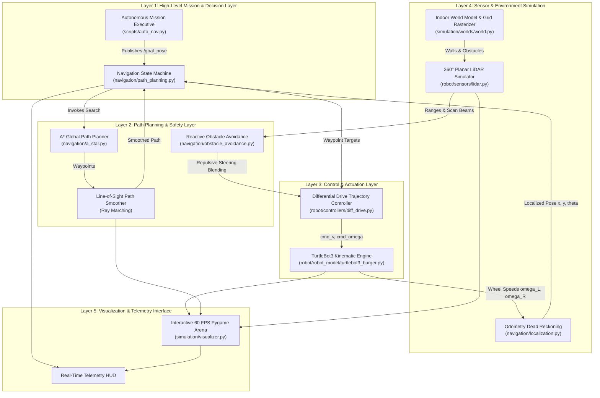
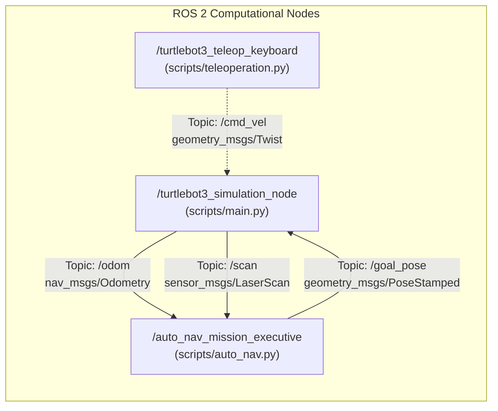
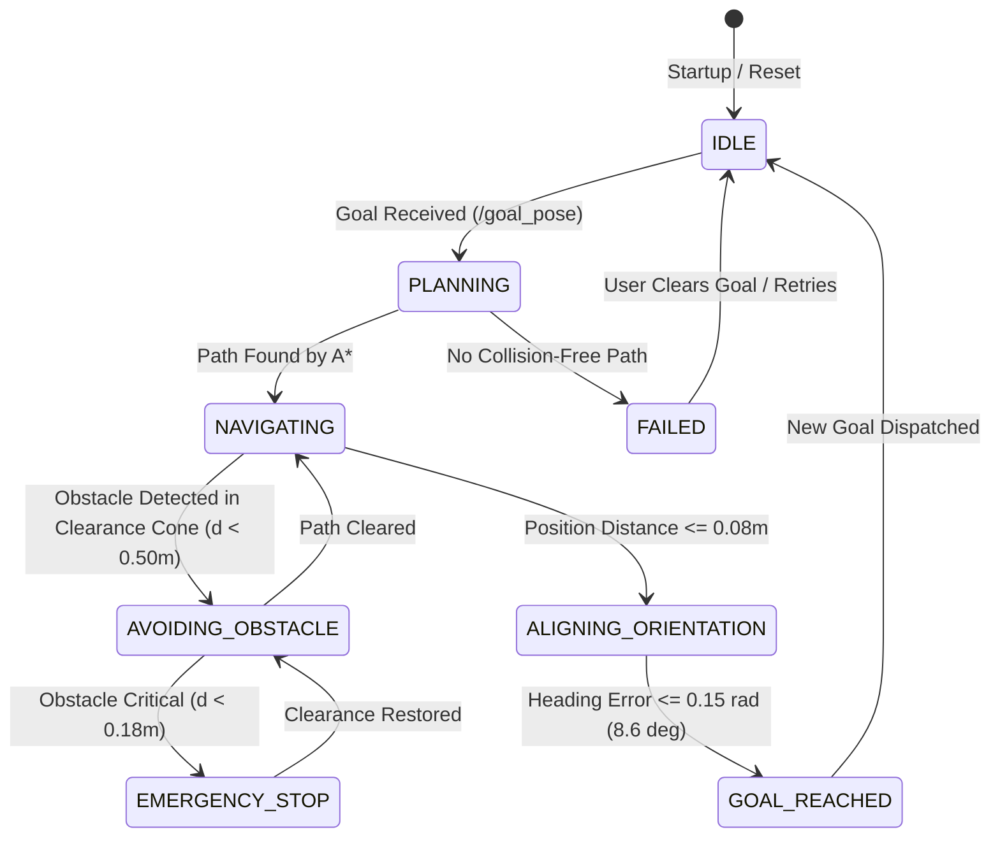

# System Architecture: TurtleBot3 Autonomous Navigation

**Target Environment:** Windows 11 Native  
**Framework:** ROS 2 Humble Hawksbill + Python 3.12 (Isolated via Pixi)  
**Laboratory Coursework:** Robotics Laboratory End-Semester Examination (ESE)  
**Reference Benchmark:** Mecharithm Lesson 9 (`auto_nav`)  

---

## 1. High-Level Architectural Overview

The system employs a modular, layered design pattern that bridges genuine ROS 2 inter-process communication with high-speed mathematical kinematic modeling and hardware-accelerated interactive visualization:

---

## 2. ROS 2 Computation Graph

The project utilizes standard, genuine ROS 2 Humble message interfaces:

### ROS 2 Message Definitions:
1. **/cmd_vel (`geometry_msgs/msg/Twist`)**:
   - `linear.x`: Desired forward/backward velocity in body frame ($m/s$).
   - `angular.z`: Desired yaw angular velocity ($rad/s$).
2. **/scan (`sensor_msgs/msg/LaserScan`)**:
   - `angle_min`: $0.0$ radians.
   - `angle_max`: $2\pi$ radians.
   - `angle_increment`: $\frac{2\pi}{360} \approx 0.01745$ radians ($1^\circ$).
   - `range_min`: $0.12$ m.
   - `range_max`: $3.50$ m.
   - `ranges`: Array of 360 float range measurements.
3. **/odom (`nav_msgs/msg/Odometry`)**:
   - `pose.pose.position`: Cartesian coordinates $(x, y, 0)$.
   - `pose.pose.orientation`: 3D quaternion $(x=0, y=0, z=\sin(\theta/2), w=\cos(\theta/2))$.
   - `twist.twist.linear.x`: Estimated body linear velocity $v$.
   - `twist.twist.angular.z`: Estimated yaw angular velocity $\omega$.
4. **/goal_pose (`geometry_msgs/msg/PoseStamped`)**:
   - `pose.position`: Target destination coordinates $(x_{goal}, y_{goal})$.
   - `pose.orientation`: Target orientation quaternion $(0, 0, \sin(\theta_{goal}/2), \cos(\theta_{goal}/2))$.

---

## 3. Finite State Machine (FSM)

The navigation state machine governs autonomous transitions across the mission lifecycle:

---

## 4. Mathematical & Kinematic Formulations

### 4.1 Differential-Drive Mobile Robot Kinematics
A differential-drive robot is constrained by the non-holonomic constraint: it cannot travel directly sideways in the instantaneous lateral direction ($\dot{y}_{body} = 0$).

Given:
- Wheel radius: $r = 0.033\text{ m}$
- Track width (distance between wheels): $L = 0.160\text{ m}$
- Left and right wheel angular velocities: $\omega_L, \omega_R\text{ (rad/s)}$

**Forward Kinematics:**
$$v = \frac{r}{2}(\omega_R + \omega_L)$$
$$\omega = \frac{r}{L}(\omega_R - \omega_L)$$

**Inverse Kinematics:**
$$\omega_R = \frac{2v + \omega L}{2r}$$
$$\omega_L = \frac{2v - \omega L}{2r}$$

**Runge-Kutta 2nd-Order (RK2) Numerical Pose Integration:**
$$\theta_{mid} = \theta_t + \frac{1}{2}\omega \Delta t$$
$$x_{t+1} = x_t + v \cos(\theta_{mid}) \Delta t$$
$$y_{t+1} = y_t + v \sin(\theta_{mid}) \Delta t$$
$$\theta_{t+1} = \text{atan2}(\sin(\theta_t + \omega \Delta t), \cos(\theta_t + \omega \Delta t))$$

---

### 4.2 LiDAR Planar Raycasting Intersection
Each laser ray is defined parametrically by:
$$\mathbf{p}(t) = \mathbf{r}_0 + t \cdot \mathbf{\hat{d}}, \quad t \ge 0$$
where $\mathbf{r}_0 = (x_{robot}, y_{robot})$ is the sensor origin, and $\mathbf{\hat{d}} = (\cos(\theta + \phi_i), \sin(\theta + \phi_i))$ is the beam unit vector.

**Ray-Line Segment Intersection:**
For a wall segment connecting $\mathbf{w}_1$ to $\mathbf{w}_2$:
$$t = \frac{(\mathbf{w}_1 - \mathbf{r}_0) \times \mathbf{\Delta w}}{\mathbf{\hat{d}} \times \mathbf{\Delta w}}, \quad u = \frac{(\mathbf{w}_1 - \mathbf{r}_0) \times \mathbf{\hat{d}}}{\mathbf{\hat{d}} \times \mathbf{\Delta w}}$$
A collision occurs if $t > 0$ and $0 \le u \le 1$. The closest distance is:
$$d_{measured} = \min_{walls, obstacles} t_i + \mathcal{N}(0, \sigma^2)$$

---

### 4.3 A* Global Path Planning
The A* search algorithm evaluates nodes using:
$$f(n) = g(n) + h(n)$$
where $g(n)$ is the exact accumulated cost from the start node, and $h(n)$ is the Euclidean distance heuristic:
$$h(n) = \sqrt{(x_{goal} - x_n)^2 + (y_{goal} - y_n)^2}$$
Because the Euclidean metric represents the straight-line distance, it obeys the triangle inequality:
$$h(n) \le c(n, n') + h(n')$$
This guarantees **heuristic consistency (monotonicity)**, proving mathematically that A* will find the optimal path without re-expanding closed nodes.

---

### 4.4 Artificial Potential Field (APF) Reactive Avoidance
The robot moves in a virtual potential field generated by the destination (attractive) and obstacle rays (repulsive):
$$U_{total} = U_{att} + U_{rep}$$
$$\mathbf{F}_{total} = -\nabla U_{total} = \mathbf{F}_{att} + \sum_{i} \mathbf{F}_{rep, i}$$

The repulsive force from LiDAR beam $i$ within warning distance $d_0$ is:
$$\mathbf{F}_{rep, i} = \begin{cases} 
\eta \left(\frac{1}{d_i} - \frac{1}{d_0}\right) \frac{1}{d_i^2} (-\mathbf{\hat{d}}_i) & \text{if } d_i \le d_0 \\
\mathbf{0} & \text{if } d_i > d_0
\end{cases}$$
The lateral component of $\mathbf{F}_{total}$ generates a corrective angular velocity $\Delta \omega$, steering the robot smoothly around unexpected obstacles.
