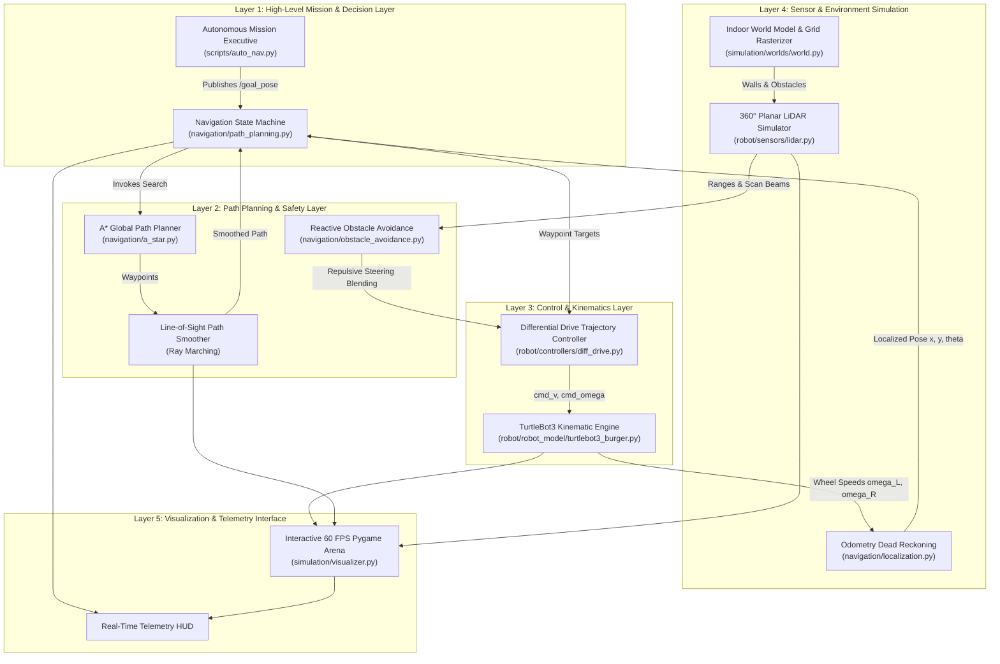

# TurtleBot3 Autonomous Navigation: Complete Project Guide (CSE Edition)

> **Target Audience:** Computer Science & Engineering (CSE) Students  
> **Course/Exam:** Robotics Laboratory End-Semester Examination (ESE)  
> **Reference Benchmark:** Mecharithm Lesson 9 (`auto_nav`)  
> **Operating Environment:** Windows 11 Native (Python 3.12 + ROS 2 Humble via Pixi)

---

## 1. Executive Summary

This project implements an **Autonomous Mobile Robot (AMR)** simulation modeled after the **ROBOTIS TurtleBot3 Burger**. 

### The CS Analogy
Think of this project as a **self-driving car in a 2D game arena**:
1. You **left-click** anywhere on screen to dispatch a destination coordinate.
2. The robot treats the floor as a **2D graph matrix** and uses the **A\* graph search algorithm** to find the shortest collision-free path.
3. It drives along that path using **differential-drive kinematics** (converting linear/angular velocity commands into separate left and right wheel motor speeds).
4. As it travels, it fires **360 virtual laser rays (LiDAR)** every frame to measure distance to walls and obstacles via 2D raycasting.
5. If you **right-click** to drop an obstacle onto its path while it is moving, the robot detects the obstruction in real time and **dynamically re-routes** around it to reach the destination safely.
6. The entire system is displayed on an **interactive 60 FPS hardware-accelerated Pygame window** with a dark-mode telemetry HUD.

---

## 2. Computer Science Translation Dictionary

Every robotics concept maps directly to a standard Computer Science fundamental:

| Robotics Term | Computer Science Equivalent | What It Does In This Codebase | File |
| :--- | :--- | :--- | :--- |
| **ROS 2 (Robot Operating System)** | **Distributed Middleware / Message Broker** (like Kafka or RabbitMQ) | Provides an asynchronous Publish/Subscribe messaging bus for independent processes to talk. | [`scripts/main.py`](file:///c:/dev/TurtleBot3_ESE/scripts/main.py) |
| **Node** | **Microservice / OS Process** | An independent executable process performing one dedicated job (e.g., path planner, sensor driver). | [`scripts/auto_nav.py`](file:///c:/dev/TurtleBot3_ESE/scripts/auto_nav.py) |
| **Topic** | **Event-Driven Pub/Sub Channel** | Named queue where nodes stream data continuously (e.g., `/scan`, `/odom`, `/cmd_vel`). | [`docs/architecture.md`](file:///c:/dev/TurtleBot3_ESE/docs/architecture.md) |
| **Occupancy Grid** | **2D Bitmask Matrix / 2D Array** (`int8[160][200]`) | Discretizes the 10 m $\times$ 8 m floor into $5\text{ cm}$ cells (`0` = free, `100` = obstacle). | [`simulation/worlds/world.py`](file:///c:/dev/TurtleBot3_ESE/simulation/worlds/world.py) |
| **A\* Path Planning** | **Graph Search using a Min-Heap Priority Queue** | Computes the shortest path from start to goal node using $f(n) = g(n) + h(n)$ with Euclidean heuristic. | [`navigation/a_star.py`](file:///c:/dev/TurtleBot3_ESE/navigation/a_star.py) |
| **Path Smoothing** | **Line-of-Sight Ray Marching / Shortcutting** | Eliminates jagged staircase grid turns by drawing direct straight sightlines across visible nodes. | [`navigation/a_star.py`](file:///c:/dev/TurtleBot3_ESE/navigation/a_star.py) |
| **LiDAR Sensor** | **Array of 360 Floats via 2D Raycasting** | Casts 360 lines outwards from the robot center to compute line-segment and circle intersections. | [`robot/sensors/lidar.py`](file:///c:/dev/TurtleBot3_ESE/robot/sensors/lidar.py) |
| **Kinematics Engine** | **Physics Engine / Coordinate Transform Matrix** | Transforms high-level $(v, \omega)$ velocity commands into wheel motor speeds $(\omega_L, \omega_R)$ and updates $(x, y, \theta)$. | [`robot/robot_model/turtlebot3_burger.py`](file:///c:/dev/TurtleBot3_ESE/robot/robot_model/turtlebot3_burger.py) |
| **Dead Reckoning (Odometry)** | **Numerical Integration Accumulator** | Integrates wheel rotations over time $\Delta t$ using Second-Order Runge-Kutta (RK2) to estimate robot pose. | [`navigation/localization.py`](file:///c:/dev/TurtleBot3_ESE/navigation/localization.py) |
| **Trajectory Follower** | **Closed-Loop Feedback Controller (P-Controller)** | Calculates steering error angles and velocity commands to guide the robot along path waypoints. | [`robot/controllers/diff_drive.py`](file:///c:/dev/TurtleBot3_ESE/robot/controllers/diff_drive.py) |
| **Reactive Avoidance (APF)** | **Virtual Repulsive Vector Field** | Translates close laser rays into repulsive forces pushing the robot away from imminent collisions. | [`navigation/obstacle_avoidance.py`](file:///c:/dev/TurtleBot3_ESE/navigation/obstacle_avoidance.py) |
| **Navigator Brain** | **Finite State Machine (FSM)** | Manages mission transitions: `IDLE` $\to$ `PLANNING` $\to$ `NAVIGATING` $\to$ `ALIGNING` $\to$ `GOAL_REACHED`. | [`navigation/path_planning.py`](file:///c:/dev/TurtleBot3_ESE/navigation/path_planning.py) |
| **Visualizer** | **2D Game Engine (Pygame 60 FPS Loop)** | Handles input events, coordinate scaling (meters to screen pixels), and double-buffered graphics rendering. | [`simulation/visualizer.py`](file:///c:/dev/TurtleBot3_ESE/simulation/visualizer.py) |

---

## 3. Five-Layer Architecture

The codebase follows a modular 5-layer separation of concerns:



---

## 4. Deep-Dive: How Each Subsystem Works

### 4.1 ROS 2 Computation Graph (Pub/Sub Messaging)

The system communicates over standard ROS 2 message interfaces:

```mermaid
graph LR
    NavNode["/auto_nav_mission_executive<br>(scripts/auto_nav.py)"] -->|/goal_pose<br>(geometry_msgs/PoseStamped)| SimNode["/turtlebot3_simulation_node<br>(scripts/main.py)"]
    TeleopNode["/turtlebot3_teleop_keyboard<br>(scripts/teleoperation.py)"] -.->|/cmd_vel<br>(geometry_msgs/Twist)| SimNode
    SimNode -->|/odom<br>(nav_msgs/Odometry)| NavNode
    SimNode -->|/scan<br>(sensor_msgs/LaserScan)| NavNode
```

* **/goal_pose (`PoseStamped`)**: Contains target coordinates $(x_{goal}, y_{goal})$ and orientation quaternion $(z, w)$.
* **/cmd_vel (`Twist`)**: Contains linear forward speed $v_x$ (in $\text{m/s}$) and angular yaw rate $\omega_z$ (in $\text{rad/s}$).
* **/scan (`LaserScan`)**: Array of 360 float distance measurements.
* **/odom (`Odometry`)**: Current position $(x, y)$ and heading angle $\theta$ computed by wheel rotation dead reckoning.

---

### 4.2 The Environment & Occupancy Grid Matrix

The continuous simulation world is $10.0\text{ m}$ wide by $8.0\text{ m}$ high. For pathfinding, it is converted into a discrete 2D matrix:

$$\text{Columns} = \frac{10.0\text{ m}}{0.05\text{ m}} = 200, \quad \text{Rows} = \frac{8.0\text{ m}}{0.05\text{ m}} = 160$$

* `grid[row, col] == 0`: Free floor cell.
* `grid[row, col] == 100`: Occupied obstacle cell.

#### The "Point-Robot" Trick (Obstacle Inflation)
A physical robot has width and length. Checking physical dimensions at every graph step is computationally slow. Instead:
* We artificially **inflate** every wall and obstacle outward by the robot's safety radius ($0.22\text{ m}$).
* Now, the pathfinding algorithm can treat the robot as a **single dimensionless point** $(x, y)$. If the point doesn't touch the inflated boundary, the physical robot will not hit the actual obstacle.

#### Vectorized Rasterization (80x Speedup)
Instead of slow nested Python loops over 32,000 cells, [`IndoorWorld.generate_occupancy_grid`](file:///c:/dev/TurtleBot3_ESE/simulation/worlds/world.py#L172) uses NumPy array broadcasting to compute boundaries, interior walls, and obstacle masks simultaneously, executing in **$1.9\text{ ms}$** instead of $160\text{ ms}$.

---

### 4.3 A\* Pathfinding & Line-of-Sight Smoothing

#### 1. A\* Search ([`navigation/a_star.py`](file:///c:/dev/TurtleBot3_ESE/navigation/a_star.py))
* Treats each cell as a graph node with 8 connected neighbors (North, South, East, West, and 4 diagonals).
* Evaluates nodes using a Min-Heap priority queue (`heapq`):
  $$f(n) = g(n) + h(n)$$
  * $g(n)$: Exact travel cost accumulated from the start node.
  * $h(n)$: Euclidean distance heuristic to the goal node ($\sqrt{(x_g - x)^2 + (y_g - y)^2}$).
* Because straight-line distance never overestimates the true cost ($h(n) \le h^*(n)$), A\* is mathematically guaranteed to find the **optimal shortest path**.

#### 2. Line-of-Sight Path Smoothing (Ray Marching)
The raw output of an 8-connected grid search is full of jagged $45^\circ$ zig-zag steps.  
The path smoother walks through the waypoints and performs ray marching: if a direct straight line can connect waypoint $i$ to waypoint $k$ without colliding with an obstacle, all intermediate waypoints are deleted. This compresses hundreds of grid steps into 2 to 5 clean straight segments.

---

### 4.4 LiDAR Sensor Simulation (2D Raycasting)

The simulated laser scanner ([`robot/sensors/lidar.py`](file:///c:/dev/TurtleBot3_ESE/robot/sensors/lidar.py)) mimics the LDS-01 sensor mounted on top of the robot:
* Projects 360 rays in a circle at $1^\circ$ increments ($0$ to $2\pi$ radians).
* For each ray, computes analytical 2D geometry intersections:
  * **Ray-Line Segment Intersection:** Solves vector cross-products against all wall segments.
  * **Ray-Circle Intersection:** Solves the quadratic equation root for circular obstacles.
* Returns an array of 360 distance values between `min_range` ($0.12\text{ m}$) and `max_range` ($3.50\text{ m}$).

---

### 4.5 Differential-Drive Kinematics & Physics Engine

The TurtleBot3 Burger chassis has two coaxial drive wheels (radius $r = 0.033\text{ m}$) separated by track width $L = 0.160\text{ m}$. It has no steering rack; it turns by spinning its left and right wheels at different speeds.

```
       [Left Wheel] ──── Speed: omega_L
           │
           │ <────── Width: L (0.160 m) ──────>
           │
       [Right Wheel] ─── Speed: omega_R
```

#### Inverse Kinematics (Body Velocity $\to$ Motor Speeds)
Given desired forward speed $v$ and turn rate $\omega$:
$$\omega_R = \frac{2v + \omega L}{2r}, \quad \omega_L = \frac{2v - \omega L}{2r}$$

#### Forward Kinematics (Motor Speeds $\to$ Body Velocity)
$$v = \frac{r}{2}(\omega_R + \omega_L), \quad \omega = \frac{r}{L}(\omega_R - \omega_L)$$

#### Numerical Pose Integration (Second-Order Runge-Kutta / RK2)
To calculate how $(x, y, \theta)$ changes over elapsed time $\Delta t$, the physics engine calculates mid-step angle $\theta_{mid} = \theta + \frac{1}{2}\omega\Delta t$ and integrates:
$$x_{t+1} = x_t + v \cos(\theta_{mid})\Delta t, \quad y_{t+1} = y_t + v \sin(\theta_{mid})\Delta t$$

---

### 4.6 Navigation State Machine (FSM)

The high-level mission manager ([`navigation/path_planning.py`](file:///c:/dev/TurtleBot3_ESE/navigation/path_planning.py)) coordinates the mission through a Finite State Machine:

```
[IDLE]
  │ (User sets destination via Left-Click)
  ▼
[PLANNING] ──(A* finds valid path)──► [NAVIGATING]
                                           ▲  │
                       (Path clear again)  │  │ (Obstacle detected on path)
                                           │  ▼
                                   [AVOIDING_OBSTACLE]
                                           │
                              (Arrived within 8 cm of goal)
                                           ▼
                                [ALIGNING_ORIENTATION]
                                           │
                              (Pivoted to desired yaw angle)
                                           ▼
                                     [GOAL_REACHED]
```

---

### 4.7 Dynamic Path Re-Routing Engine

#### How It Works:
1. **Obstacle Placement:** When the user right-clicks the arena floor, a dynamic obstacle is added to the world and the occupancy grid is updated.
2. **Path Obstruction Check (`is_path_obstructed`):** The system checks all line segments from the robot's current position through remaining upcoming waypoints against the new obstacle geometry.
3. **Triggering Re-Route (`replan`):** If the path is blocked, the navigator immediately queries A\* from the robot's current continuous coordinates to the destination, routing cleanly around the newly placed obstacle.
4. **Collision Margin Calibration:** Uses physical robot clearance ($0.12\text{ m}$) rather than planning inflation margin ($0.22\text{ m}$), preventing false replanning triggers when curving past obstacle edges.

---

## 5. End-to-End Walkthrough of a Navigation Mission

1. **Initialization:** User executes `python scripts/main.py`. The Pygame window initializes at 60 FPS. The robot starts stationary at $(1.2\text{ m}, 1.5\text{ m})$ in state `IDLE`.
2. **Goal Command:** User left-clicks on screen at $(8.5\text{ m}, 4.8\text{ m})$.
   * A\* plans a path, smooths it into waypoints, and sets state to `NAVIGATING`.
3. **Motion Execution:** The trajectory controller computes forward velocity $v$ and steering $\omega$ toward waypoint 1. Kinematics spins the wheels, odometry accumulates $(x, y, \theta)$, and a yellow trail shows the trajectory taken.
4. **Interactive Obstacle Placement:** While the robot is driving across the arena, user right-clicks directly on the green path ahead of the robot.
   * A red circle obstacle is created.
   * `is_path_obstructed` flags the collision.
   * A\* recalculates a new collision-free path in $<2\text{ ms}$.
   * The green path line instantly bends around the red circle.
   * The robot steers around the obstacle without stopping.
5. **Goal Arrival:** Once the robot gets within $8\text{ cm}$ of the final target, it halts linear motion ($v = 0.0\text{ m/s}$), pivots in place to match the requested orientation angle, and transitions to `GOAL_REACHED`.

---

## 6. Project Directory Map

```
c:\dev\TurtleBot3_ESE/
├── config/
│   ├── robot_config.yaml       # Physical specifications (wheel radius, track width, velocity limits)
│   └── world_config.yaml       # Arena size (10m x 8m), wall segments, default start/goal positions
├── docs/
│   ├── architecture.md         # Detailed software architecture and node graph diagrams
│   ├── cse_project_guide.md    # This comprehensive CSE guide
│   ├── installation.md         # Windows 11 setup and environment commands
│   ├── project_report.md       # Formal academic laboratory report
│   ├── ppt_outline.md          # 12-slide presentation outline for viva defense
│   └── viva_questions.md       # 45 exhaustive viva questions & answers
├── navigation/
│   ├── a_star.py               # A* optimal path planning and line-of-sight ray marching
│   ├── localization.py         # Wheel odometry dead reckoning and pose estimation
│   ├── obstacle_avoidance.py   # Reactive Artificial Potential Field (APF) and safety gating
│   └── path_planning.py        # AutonomousNavigator FSM, dynamic re-routing & waypoint follower
├── robot/
│   ├── controllers/
│   │   └── diff_drive.py       # P-controller for waypoint tracking & angle normalization
│   ├── robot_model/
│   │   ├── turtlebot3_burger.py# Differential-drive kinematics & RK2 numerical integration
│   │   └── turtlebot3_waffle.py# Alternative Waffle model specifications
│   └── sensors/
│       └── lidar.py            # 360-degree planar laser raycasting simulator
├── scripts/
│   ├── auto_nav.py             # Mecharithm Lesson 9 programmatic multi-point mission executive
│   ├── main.py                 # Master orchestrator (integrates ROS 2, Pygame, physics & AI)
│   ├── record_demonstration.py # Automated demonstration runner & report screenshot recorder
│   └── teleoperation.py        # Standalone terminal keyboard teleoperation node
├── simulation/
│   ├── obstacles/
│   │   └── obstacle.py         # Geometric representations (CircleObstacle, BoxObstacle)
│   ├── visualizer.py           # 60 FPS hardware-accelerated Pygame visual engine & HUD
│   └── worlds/
│       └── world.py            # World layout manager & vectorized occupancy grid rasterizer
├── tests/
│   ├── run_all_tests.py        # Master test runner script
│   ├── test_a_star.py          # Unit tests for A* planning & line-of-sight smoothing
│   ├── test_kinematics.py      # Unit tests for differential drive kinematics & velocity limits
│   ├── test_lidar.py           # Unit tests for 360-beam LiDAR raycasting accuracy
│   ├── test_navigation_integration.py # Full closed-loop integration & dynamic re-routing tests
│   └── test_obstacle_avoidance.py     # Unit tests for emergency stop & APF steering
├── pixi.toml                   # Pixi deterministic package manifest (Conda / ROS 2 Humble)
└── README.md                   # Project overview, quickstart instructions & controls
```

---

## 7. Interactive Controls Reference

When running `python scripts/main.py`:

| Control | Action | CSE Analogy |
| :--- | :--- | :--- |
| **Left Mouse Click** | Set new navigation goal at click position | RPC command: `set_goal(x, y)` |
| **Right Mouse Click** | Place a dynamic obstacle on the fly (re-routes bot!) | State mutation: `add_obstacle()` + `replan()` |
| **Space / A** | Start / trigger autonomous navigation | State machine transition to `NAVIGATING` |
| **T** | Toggle between Autonomous and Manual Teleop mode | Control multiplexer (AI planner vs manual input) |
| **W / A / S / D** | Drive robot manually (when in Teleoperation mode) | Direct velocity input: `W` forward, `S` backward, `A`/`D` turn |
| **P** | Capture high-resolution screenshot to `screenshots/` | Framebuffer grab saved to PNG |
| **R** | Reset robot back to start pose `(1.2, 1.5, 0.0)` | State reset: `reset_pose()` |
| **C** | Clear all custom obstacles back to clean arena floor | List clear: `obstacles.clear()` |
| **O** | Load preset laboratory interior walls and divider columns | Preset state loader |

---

## 8. Top 8 Viva & Defense Questions (CSE Focused)

### Q1: What algorithm is used for global path planning, and why?
**Answer:** A\* (A-Star) search algorithm. It runs over an 8-connected discrete 2D occupancy grid using a Min-Heap priority queue (`heapq`). We use the straight-line Euclidean distance heuristic $h(n)$, which is admissible ($h(n) \le h^*(n)$), mathematically guaranteeing the optimal shortest collision-free path.

### Q2: Why is path smoothing needed after A\*?
**Answer:** Raw A\* produces jagged staircase movements constrained to $45^\circ$ and $90^\circ$ grid steps. The Line-of-Sight smoother uses ray marching: if a straight collision-free line exists between node $i$ and node $k$, all intermediate points are removed, reducing hundreds of jerky steps into 2 to 5 smooth waypoints.

### Q3: How does the robot detect and avoid obstacles placed while it is moving?
**Answer:** Dual-layer approach:
1. **Global Re-routing:** When an obstacle is added, `is_path_obstructed()` samples points along the upcoming trajectory. If a collision is flagged, A\* immediately re-plans a new global path around the obstacle.
2. **Local Reactive Avoidance (APF):** The 360-degree LiDAR continuously measures real-time distances. If an obstacle is within the emergency threshold ($0.18\text{ m}$), the robot immediately stops linear speed and turns away from the closer side.

### Q4: How is ROS 2 different from ROS 1?
**Answer:** ROS 1 required a centralized master process (`roscore`), making it a single point of failure and incompatible with Windows. ROS 2 is built on **DDS (Data Distribution Service)**, a peer-to-peer UDP protocol with dynamic discovery, real-time Quality of Service (QoS), and native cross-platform support.

### Q5: What is the difference between `/cmd_vel` and `/odom`?
**Answer:**
* `/cmd_vel` is an **input control command** (`geometry_msgs/Twist`) telling the robot what velocity it *should* have.
* `/odom` is an **output feedback measurement** (`nav_msgs/Odometry`) reporting where the robot *actually is* based on wheel encoder dead reckoning.

### Q6: What is obstacle inflation, and why is it used?
**Answer:** The physical robot has radius $\approx 10.5\text{ cm}$. Instead of calculating physical geometry bounding box checks during graph search, we inflate all obstacles outward by $22\text{ cm}$. This allows A\* to treat the robot as a single dimensionless mathematical point.

### Q7: Why did we optimize grid generation with NumPy?
**Answer:** The original implementation looped cell-by-cell in pure Python over 32,000 cells (160 rows $\times$ 200 cols), taking $160\text{ ms}$ on every obstacle placement, which caused visible simulation freezing. By vectorizing the distance computations using NumPy 2D array broadcasting, execution time dropped to **$1.9\text{ ms}$** (~80x speedup), preserving smooth 60 FPS performance.

### Q8: How does the robot know it has reached its destination?
**Answer:** In [`AutonomousNavigator.update`](file:///c:/dev/TurtleBot3_ESE/navigation/path_planning.py#L180), it calculates Euclidean distance $\sqrt{(x_{goal} - x)^2 + (y_{goal} - y)^2}$. If distance $\le 0.08\text{ m}$ ($8\text{ cm}$ tolerance), it transitions to `ALIGNING_ORIENTATION`, rotates until angular error $\le 0.15\text{ rad}$, stops both wheels ($v=0, \omega=0$), and transitions to `GOAL_REACHED`.

